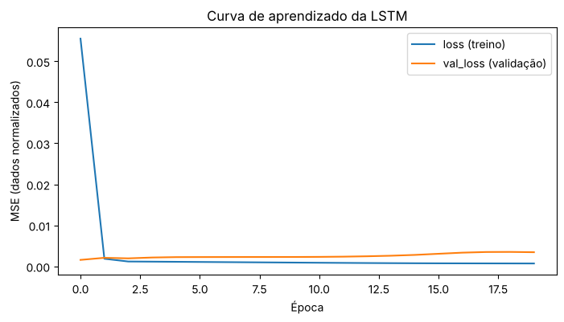
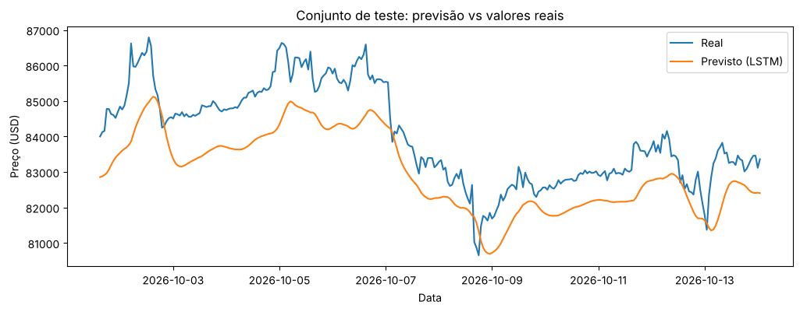
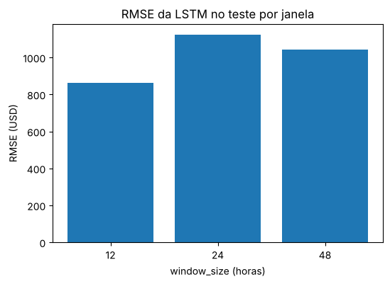
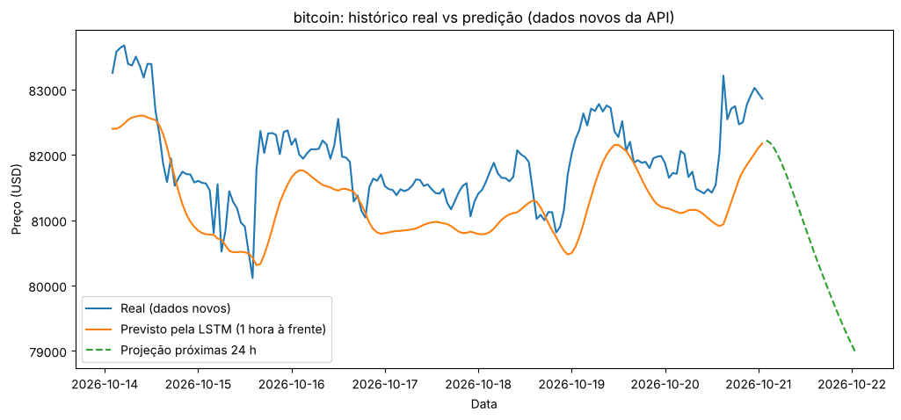

# CP2 — Previsão de preço de criptomoeda com LSTM

**Integrante:** Rodrigo Leme — RM550266

Projeto que usa uma Rede Neural Recorrente (**LSTM**) para prever o preço do **Bitcoin** de hora em hora, com dados históricos da **API pública do CoinGecko**. O modelo é treinado com 83 dias de histórico e validado em **7 dias novos**, buscados novamente na API e que não foram usados no treino.

## Estrutura

```
cp2-lstm-cripto/
├── cp2_lstm_bitcoin.ipynb   # notebook comentado com todo o pipeline
├── requirements.txt         # bibliotecas necessárias
├── README.md
└── resultados/              # gerada ao rodar o notebook
    ├── 01_historico.png
    ├── 02_loss.png                       # curva loss / val_loss
    ├── 03_teste_previsto_vs_real.png     # previsão vs real no teste
    ├── 04_experimentos_val_loss.png
    ├── 05_experimentos_rmse.png
    ├── 06_predicao_dados_novos.png       # gráfico final com a predição
    ├── experimentos.csv
    └── modelo_lstm.keras                 # modelo treinado
```

## Pipeline

| Etapa | O que é feito |
|---|---|
| 1. Coleta | `get_historical_data("bitcoin", 90)` chama `/coins/bitcoin/market_chart` (90 dias, dados de hora em hora). Os últimos 7 dias são separados e não entram no treino. |
| 2. Pré-processamento | Resample para 1 hora, interpolação de valores faltantes, `MinMaxScaler` (ajustado só no treino) e janelas de 24 horas → próxima hora. |
| 3. Modelo | Divisão 70% treino / 15% validação / 15% teste em ordem temporal. LSTM(50) + Dense(1), perda MSE, otimizador Adam, 20 épocas. |
| 4. Avaliação | MSE, RMSE e MAE em dólar no conjunto de teste, comparados com o baseline de persistência (próximo = último). |
| 5. Experimentos | `window_size` de 12, 24 e 48 horas, comparando LSTM, média móvel e persistência. |
| 6. Dados novos | Nova chamada à API com `days=7`; previsão hora a hora nesses dados e projeção das próximas 24 horas. |

## Descrição do modelo

```
Entrada (24, 1)  →  LSTM (50 unidades)  →  Dense (1)  →  preço da próxima hora
```

- **Entrada:** preços normalizados das últimas 24 horas
- **Saída:** preço normalizado da próxima hora (convertido de volta para USD)
- **Perda:** MSE · **Otimizador:** Adam · **Épocas:** 20 · **Batch:** 32

## Como executar

**Google Colab (mais fácil):** abra o `cp2_lstm_bitcoin.ipynb` no Colab e clique em *Executar tudo*. As bibliotecas já vêm instaladas.

**Localmente:**

```bash
pip install -r requirements.txt
jupyter notebook cp2_lstm_bitcoin.ipynb
```

Execute as células em ordem. A pasta `resultados/` é criada automaticamente com os gráficos, a tabela de experimentos e o modelo salvo.

> A API pública do CoinGecko não exige chave, mas tem limite de requisições. O notebook faz apenas 2 chamadas (90 dias e 7 dias).

## Principais resultados

> Os valores abaixo são preenchidos após rodar o notebook (os dados mudam a cada execução, pois a API sempre devolve os últimos 90 dias).

### Conjunto de teste (window_size = 24)

| Modelo | MSE | RMSE (USD) | MAE (USD) |
|---|---|---|---|
| LSTM | | | |
| Persistência | | | |

### Experimentos (RMSE no teste, USD)

| window_size | LSTM | Média móvel | Persistência |
|---|---|---|---|
| 12 | | | |
| 24 | | | |
| 48 | | | |

### Dados novos (últimos 7 dias)

| Modelo | MSE | RMSE (USD) | MAE (USD) |
|---|---|---|---|
| LSTM | | | |
| Persistência | | | |

### Gráficos

**Curva de aprendizado (loss / val_loss)**



**Previsão vs real no teste**



**Experimentos com window_size**



**Predição em dados novos + projeção das próximas 24 horas**



## Observações

- Em preços de hora em hora, o baseline de persistência costuma ter erro muito baixo, porque o preço varia pouco de uma hora para outra. Por isso ele é a referência principal para avaliar a LSTM.
- A projeção de 24 horas usa cada previsão como entrada da seguinte, então o erro aumenta conforme se afasta da última hora real e a curva tende a ficar mais suave.
- O projeto é acadêmico e não deve ser usado como recomendação de investimento.
